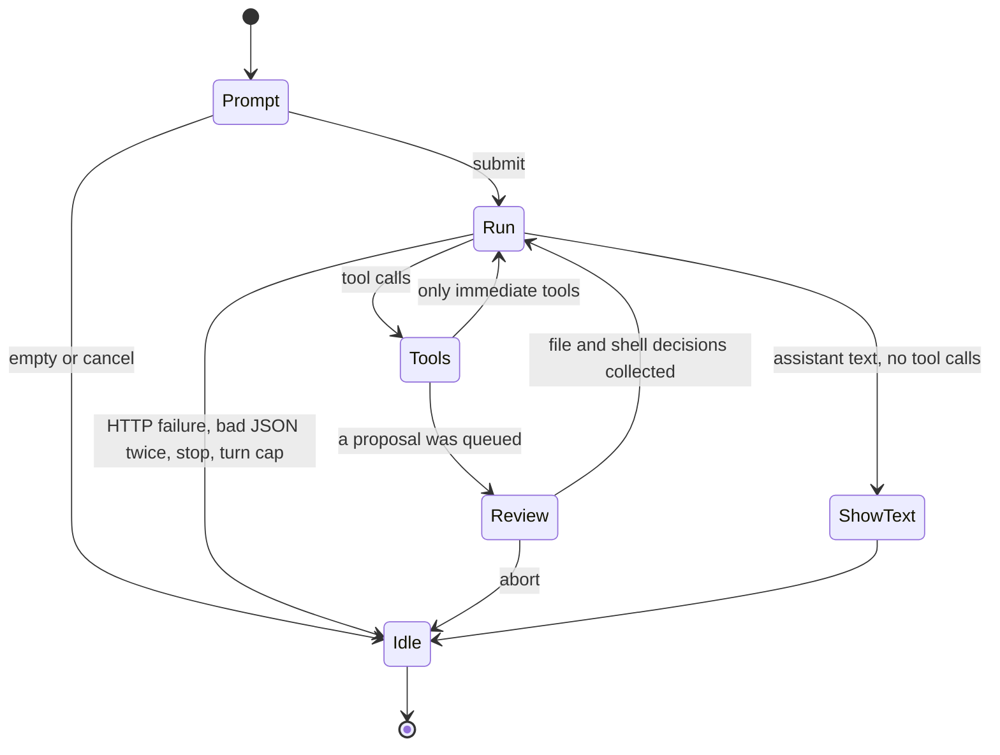

# Agent loop

One `:Proposal` (or `<leader>Aa` / `<leader>Av`) is one ask. An ask has one message list and at most `max_turns` provider calls (default 8). A turn is one call to `provider.complete`.

## States

`Idle` is the only state in which `<leader>Aa` starts a new ask. A second ask while one is running is refused with `proposal.nvim: busy`.

## Prompt

Floating scratch buffer, `buftype=nofile`, opened in insert mode.

| Input | Result |
| --- | --- |
| Normal-mode `<CR>`, or insert-mode `<C-s>` | Submit the buffer text |
| Normal-mode `q`, or `<C-c>` | Cancel. No provider call |
| Empty submit | Cancel |

`<leader>Av` records the visual selection before the prompt opens. The selection is context only. It is not a proposal.

## First message

The list starts as:

1. `system`: the fixed prompt in the [tool protocol](tool-protocol.md#system-prompt).
2. `user`: the context pack from `context.build`.

Later turns append `assistant` messages and `tool` messages. The context pack is not sent again.

## A turn

1. Call `complete(messages, tools)`. This happens at most `max_turns` times (default 8).
2. If this was turn `max_turns` and the assistant message contains tool calls, do not run them and do not open a review. Notify `proposal.nvim: stopped after <max_turns> turns`, show `message.content` when it is non-empty, and go to `Idle`.
3. No tool calls: show `message.content` in a floating buffer. Go to `Idle`.
4. For each tool call, in order:
   - `read_file`, `grep`, `diagnostics`: run now. Keep the result.
   - `propose_edit`, `propose_shell`: validate and queue, or keep `error: …`. A queued call has no model-visible result yet.
5. If the queue is non-empty, enter `Review`. The user finishes or aborts. See [Review](review.md).
6. Append one `tool` message per tool call, in the original order. Immediate tools contribute the result from step 4. Proposals contribute the review summary. Error results from step 4 are already final.
7. If the next turn would be past `max_turns`, notify `proposal.nvim: stopped after <max_turns> turns` and go to `Idle`.
8. Otherwise go back to step 1.

Abort during review or during an accepted shell command goes to `Idle` with `proposal.nvim: aborted`. No further `complete` call. Files already applied in this review stay applied.

## Stopping the provider

`:ProposalStop` and `<C-c>`:

- During `Run`, kill the `curl` process and go to `Idle`.
- During an accepted `vim.system` shell, kill that process and go to `Idle`.
- During review, follow the abort rule in [Review](review.md).

A killed HTTP call does not retry. The next `:Proposal` starts a new list.

## Bad provider payloads

A transport failure (non-zero `curl`, timeout, HTTP status outside 200–299) notifies with the status and ends the ask. v1 does not retry it.

A 200 body that is not JSON, or JSON without `choices[0].message`, appends one user message: `Reply with a tool call or a plain summary.` and calls the provider once more. That retry counts as a turn. A second failure notifies and ends the ask.

## Memory

The list lives in a Lua table owned by the ask. It is dropped on `Idle`. It is not written to shada, to `stdpath`, or to the project. Notifications never include the key or the raw response body.
